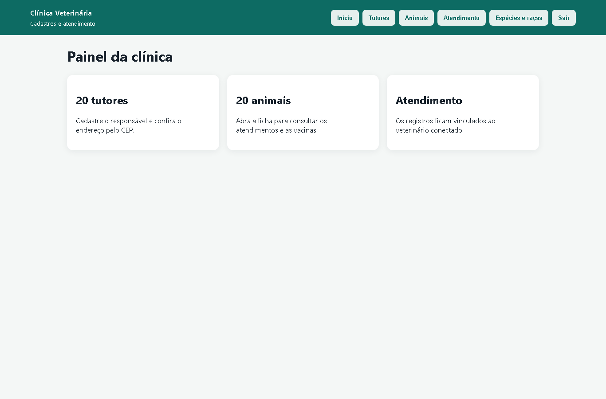
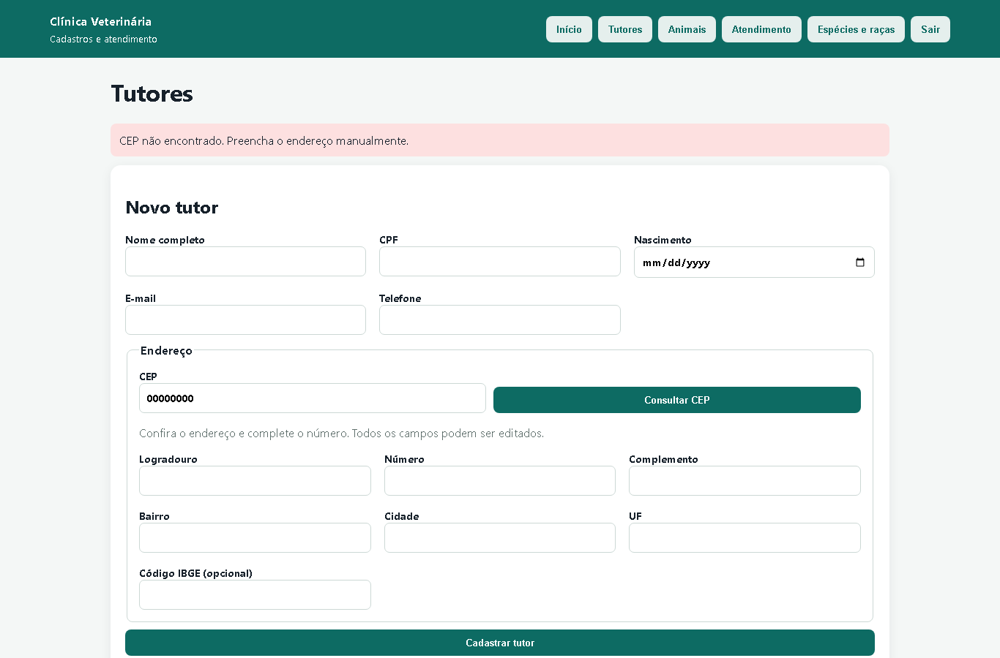
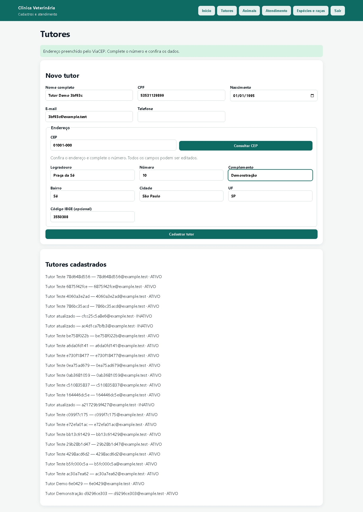
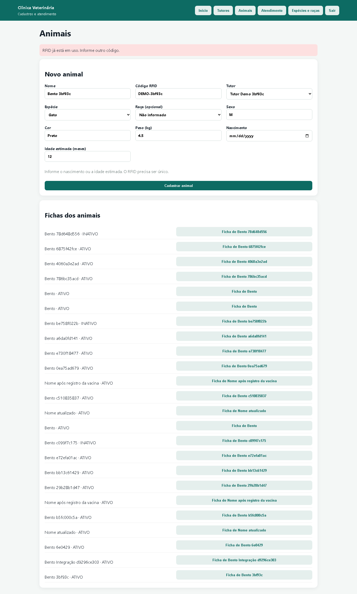
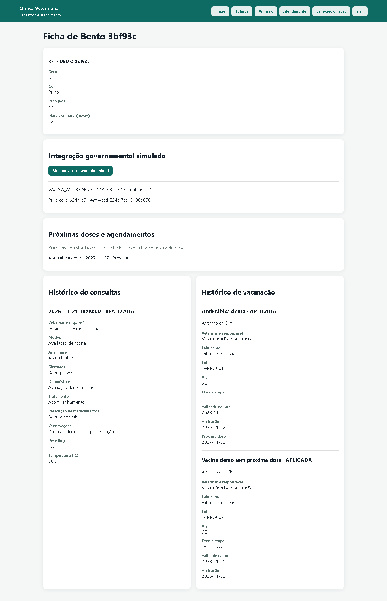
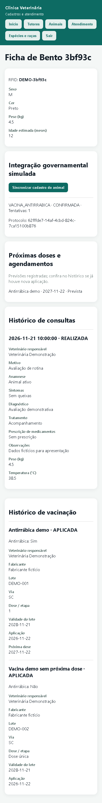
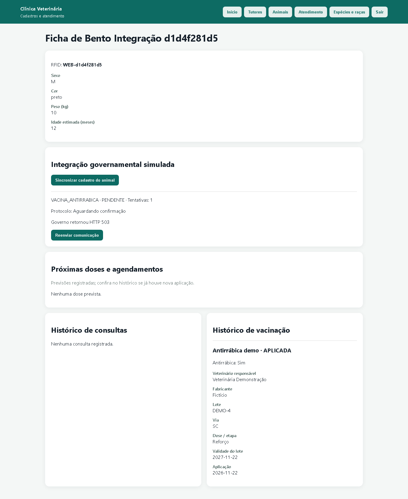
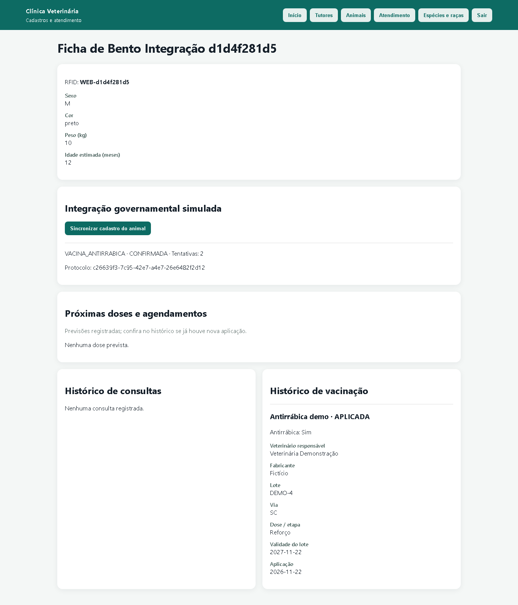

# Relatório técnico final — Milestone 5

**Projeto:** Clínica Veterinária SDM — A3 de SDM  
**Data:** 22 de novembro de 2026  
**Entrega prevista:** 26 de novembro de 2026  
**Repositório:** https://github.com/AnaHeloisaGoncalves/clinica-veterinaria-sdm

## 1. Objetivo
Validar a integração entre interface web, API privada, MySQL e governo simulado; executar testes funcionais e automatizados; registrar incidentes e correções de configuração; organizar evidências e documentar o sistema para apresentação final.

## 2. Ambiente de execução
- Windows e VS Code.
- Python 3.14 conforme requisito do repositório; ambiente virtual `.venv`.
- FastAPI e Uvicorn; API da clínica em `http://127.0.0.1:8000`.
- API de governo simulado em `http://127.0.0.1:8001`.
- MySQL 8, banco principal `clinica_vet` e banco descartável de testes `clinica_vet_testes`.
- Banco SQLite de testes do governo: `governo_testes.sqlite3`.
- `unittest` para testes automatizados e Playwright/Chromium para testes de interface.
- Dependências instaladas a partir de `requirements.txt` e `requirements-dev.txt`.

Os segredos ficam no `.env` local e **não devem ser publicados**.

## 3. Arquitetura e escopo
- **Frontend (`frontend/`)**: autenticação, tutores, animais/RFID, CEP, atendimento, vacinação e ficha/histórico.
- **API da clínica (`api_clinica/`)**: autenticação, validações, persistência MySQL e comunicação com o governo.
- **API governamental (`api_governo/`)**: simulação de recebimento de vacinação antirrábica, protocolos e idempotência, com armazenamento próprio.
- **Banco (`database/`)**: esquema relacional da clínica.
- **Testes (`tests/`)**: testes das entregas 2–4 e automações web.

## 4. Procedimentos realizados
1. Configuração do servidor MySQL e importação de `database/banco1.sql`.
2. Execução das APIs em portas distintas e configuração dos segredos de integração.
3. Preparação do banco separado `clinica_vet_testes` com 11 tabelas e permissões para `clinica_app`.
4. Verificação de `SELECT DATABASE()` no ambiente de testes.
5. Execução de testes manuais da interface com dados fictícios.
6. Execução automatizada: `python -m unittest tests.entrega2 tests.entrega3 tests.entrega4 -v`.
7. Execução dos testes de interface: `python -m tests.demo_web` e `python -m tests.demo4_web`.

## 5. Resultados
| ID | Validação | Resultado informado | Observação |
|---|---|---|---|
| M-01 | Login | Aprovado | Acesso pela interface |
| M-02 | Cadastro de tutor | Aprovado | Persistência confirmada pelo executor |
| M-03 | CEP | Aprovado | Consulta e preenchimento |
| M-04 | Cadastro de animal | Aprovado | Inicialmente suspeito; animal foi confirmado como cadastrado |
| M-05 | Registro de consulta | Aprovado | Teste manual |
| M-06 | Registro de vacina | Aprovado | Teste manual |
| M-07 | Ficha e histórico | Aprovado | Teste manual |
| M-08 | Integração governamental | Aprovado após ajuste de inicialização | Sucesso/protocolo relatado |
| A-01 | `tests.entrega2` | Aprovado no log | `test_autenticacao_e_cadastros ... ok` |
| A-02 | `tests.entrega3` | Aprovado no log | 7 casos de `tests.entrega3` com `ok` |
| A-03 | `tests.entrega4` | Aprovado no log | 3 casos de `tests.entrega4` com `ok` |
| W-01 | `tests.demo_web` | Sem erros relatados | Capturas `01-painel.png` a `06-celular.png` anexadas |
| W-02 | `tests.demo4_web` | Sem erros relatados | Capturas `m4-pendente.png` e `m4-confirmada.png` anexadas |

**Evidência publicada:** o arquivo [testes_automatizados.txt](evidencias/testes_automatizados.txt) comprova **11 testes aprovados em 8,102 segundos**, resultado `OK`. As oito capturas do Playwright estão anexadas em [evidencias/](evidencias/). Os testes web foram relatados como concluídos sem erros; seus logs específicos não estão nesta pasta.

## 6. Incidentes, diagnóstico e solução
### INC-01 — Erro 401 durante consulta governamental
- **Sintoma:** `GET /api/governo/animais/12345678` retornava `401 Unauthorized`.
- **Investigação:** conferência de autenticação e das APIs ativas. O animal já estava cadastrado localmente.
- **Desfecho:** o problema de acesso governamental foi resolvido durante a correção de inicialização das APIs; não foi comprovada uma falha no cadastro de animal.

### INC-02 — Erro 405 na vacinação antirrábica
- **Sintoma:** `POST /api/governo/vacinacoes-antirrabicas` retornava `405 Method Not Allowed`; a rota faltava no OpenAPI da porta `8001`.
- **Causa observada:** `/health` na porta `8001` identificou o serviço `api_clinica`, e não `governo-simulado`.
- **Ação:** iniciar `api_clinica.main:app` na porta 8000 e `api_governo.main:app` na porta 8001.
- **Verificação:** `/health` passou a identificar corretamente cada serviço; integração retornou sucesso ou protocolo segundo o executor.

### INC-03 — Falha de autenticação em teste automatizado
- **Sintoma:** `test_autenticacao_e_cadastros` esperava `403`, mas obteve `401` em `POST /login`.
- **Diagnóstico:** divergência entre banco usado pelo terminal de testes e banco usado pelo servidor da API.
- **Ação:** configurar `DB_NAME=clinica_vet_testes` nos ambientes da API e dos testes; reiniciar as APIs.
- **Verificação:** teste individual passou com `OK`; posteriormente suíte completa também passou segundo o executor.

### Aviso não bloqueante
Foi exibido `StarletteDeprecationWarning` envolvendo `httpx` e `starlette.testclient`. Trata-se de aviso de compatibilidade de dependências, distinto das falhas funcionais relatadas. A atualização de pacotes deve ser planejada e testada antes de ser realizada.

## 7. Segurança e dados
Os testes foram direcionados ao banco descartável `clinica_vet_testes`. O banco de demonstração `clinica_vet` foi mantido separado. Não registrar no repositório: `.env`, credenciais, tokens, arquivos SQLite com informações sensíveis, ambiente virtual ou capturas com dados pessoais.

## 8. Limitações e riscos remanescentes
- O log completo de `unittest` e as oito capturas já estão arquivados em [evidencias/](evidencias/). Não estão anexados logs próprios dos dois scripts Playwright.
- Os testes relatados foram realizados em ambiente local, não equivalendo à homologação de produção.
- A aplicação utiliza serviços externos, como ViaCEP, cuja disponibilidade pode variar.
- Não foi realizada nesta etapa auditoria formal de segurança, desempenho sob carga ou acessibilidade.

## 9. Conclusão
Com base nos resultados relatados pelo executor em 22/11/2026, os fluxos principais e as suítes automatizadas das Milestones 2, 3 e 4 passaram após correções de configuração do ambiente. A Milestone 5 reúne a validação funcional, integração, testes web, registro de incidentes e documentação. O log de 11 testes aprovados em 8,102 segundos e as oito capturas foram anexados ao repositório. A [matriz de 16 cenários](matriz_testes.md) relaciona os requisitos documentados aos testes e evidências.

## Evidências dos Testes — Milestone 5

As imagens a seguir documentam os testes visuais realizados com Playwright no Sistema de Gestão da Clínica Veterinária SDM.

### 1. Painel principal

**Validação:** Acesso ao sistema e exibição do painel principal.

### 2. Tratamento de CEP inexistente

**Validação:** Tratamento de endereço não encontrado.

### 3. Cadastro de tutor e consulta de CEP

**Validação:** Formulário de cadastro de tutor com integração de CEP.

### 4. Validação de RFID duplicado

**Validação:** Impedimento de identificadores RFID duplicados.

### 5. Histórico clínico

**Validação:** Exibição das informações clínicas, consultas e vacinas.

### 6. Interface responsiva

**Validação:** Adaptação da interface para dispositivos móveis.

### 7. Integração governamental pendente

**Validação:** Registro de uma operação pendente durante indisponibilidade do governo simulado.

### 8. Integração governamental confirmada

**Validação:** Confirmação da operação após o reenvio.

---

## Resultado dos testes

- Testes automatizados das Milestones 2, 3 e 4: **11 aprovados em 8,102 segundos**, conforme [log publicado](evidencias/testes_automatizados.txt).
- Testes visuais `tests.demo_web` e `tests.demo4_web`: **Concluídos sem erros**, conforme execução informada.
- Integração governamental: **Funcionando após correção da configuração dos servidores**.

As oito capturas estão anexadas em [evidencias/](evidencias/). O log detalhado está em [testes_automatizados.txt](evidencias/testes_automatizados.txt) e o resumo manual em [testes_manuais_resumo.txt](evidencias/testes_manuais_resumo.txt). Veja também a [matriz de 16 cenários](matriz_testes.md).
