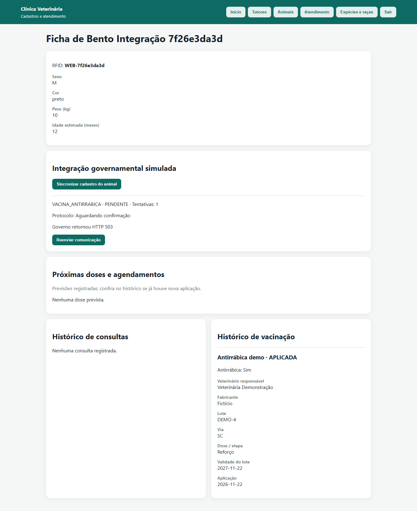
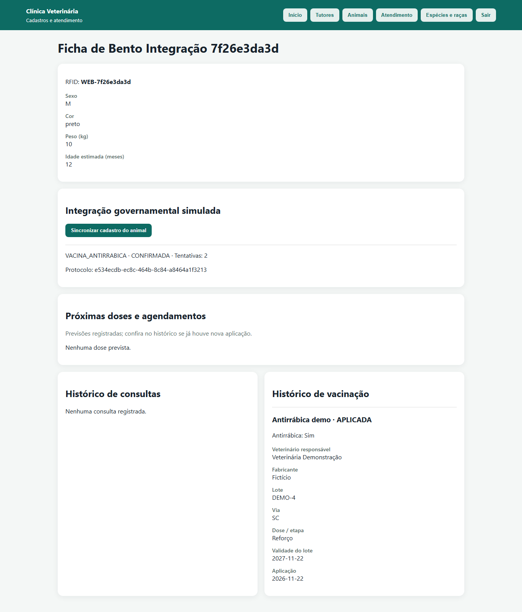

# Evidências da Milestone 4

Validação em 22/11/2026 com Python 3.14.3, MySQL 8.0.42, SQLite e Chromium. Foram usados bancos descartáveis e dados fictícios.

## Testes executados

- python -m unittest tests.entrega2 tests.entrega3 tests.entrega4 -v — 11 testes passaram.
- python -m tests.demo_web — fluxo clínico da Milestone 3 passou com ViaCEP real.
- python -m tests.demo4_web — fluxo visual de pendência e reenvio passou.
- database/milestone4.sql foi reaplicado duas vezes sobre o esquema atual sem erro.
- node --check frontend/app.js passou.

## Cenários verificados na integração

| Cenário | Resultado |
|---|---|
| Cadastro e atualização de animal no governo | Operações confirmadas e nome atualizado na consulta externa |
| Vacina aplicada com governo indisponível | Aplicação local persistida e integração PENDENTE |
| Retorno do serviço e reenvio | Integração CONFIRMADA com protocolo |
| Resposta perdida após gravação externa | Próxima tentativa retorna o protocolo original |
| Repetições concorrentes com mesma chave | Mesmo protocolo e uma única aplicação externa |
| Mesma chave com conteúdo diferente | HTTP 409 |
| Mesma aplicação com outra chave | HTTP 409 |
| Vacina não antirrábica | Aplicação local sem nova comunicação |
| Antirrábica agendada ou cancelada | Sem comunicação obrigatória |
| Chave do governo incorreta | Operação local FALHA, recuperada após corrigir a configuração |
| Mudança do nome do animal após a aplicação | Reenvio preserva os dados originais do payload |
| Endpoint governamental sem chave | HTTP 401 |

## Capturas

A ficha mostra a aplicação no histórico e o estado da comunicação pendente.

Após o reenvio, a ficha mostra a confirmação e o protocolo recebido.

O fluxo de integração também verificou ausência de rolagem horizontal em uma tela emulada de 390 × 844. Os testes de resposta perdida e indisponibilidade usam simulação controlada. A aprovação visual em celular físico permanece fora desta validação.

O governo usa SQLite separado do MySQL da clínica. A recuperação é manual pelo botão de reenvio. A instalação e os comandos estão em milestone-4.md.
