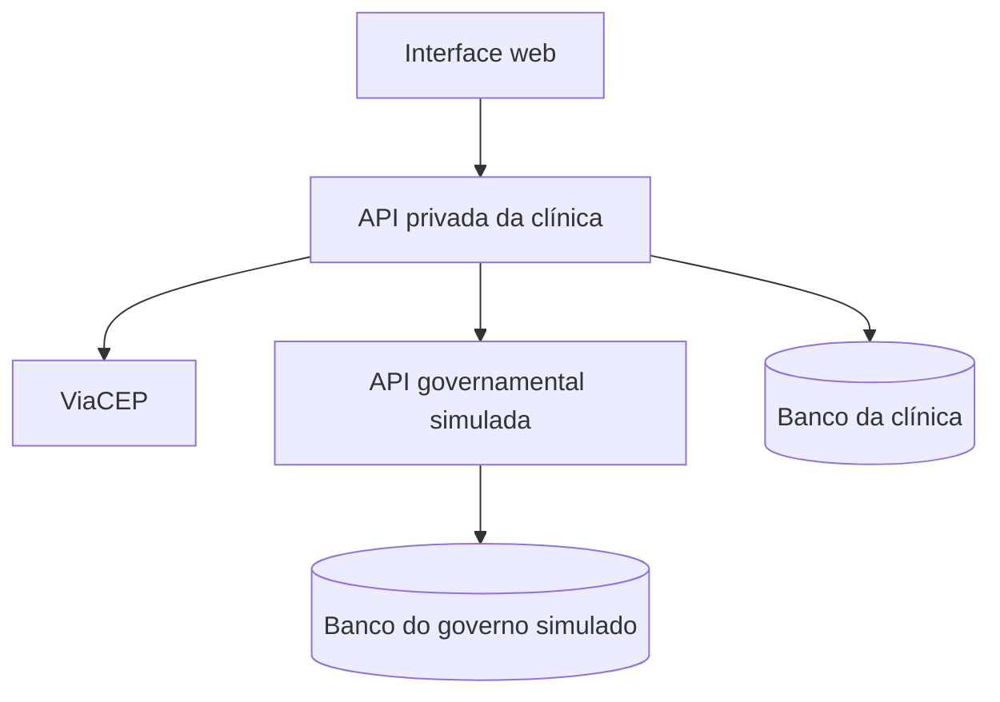

# Milestone 1 — Requisitos e arquitetura

## Requisitos funcionais

| ID | Requisito |
|---|---|
| RF01 | Cadastrar veterinários e autenticar com e-mail e senha. Armazenar a senha com hash apropriado. Enviar um código ou link de confirmação ao e-mail do veterinário e registrar a confirmação somente após a validação. O envio pode ser simulado. Bloquear contas inativas ou sem confirmação e encerrar a sessão no logout. |
| RF02 | Cadastrar, consultar, alterar e inativar tutores. Validar CPF e impedir duplicidade. |
| RF03 | Consultar o CEP no ViaCEP e preencher automaticamente os campos de endereço retornados. Permitir completar o endereço manualmente e tratar CEP inexistente, timeout e indisponibilidade. |
| RF04 | Manter catálogos de espécies e raças. A raça é opcional e precisa ser compatível com a espécie. |
| RF05 | Cadastrar, consultar e atualizar animais com tutor e microchip único. Permitir a consulta da situação da integração governamental do animal. O vínculo do microchip exige veterinário autenticado, ativo e autorizado. Registrar a data e o veterinário responsável e preservar o histórico em substituições. |
| RF06 | Registrar consultas e consultar o histórico por animal. Toda consulta tem veterinário responsável. |
| RF07 | Registrar vacinas e consultar histórico e próximas doses. A classificação antirrábica é estruturada. |
| RF08 | Cadastrar e atualizar animais na API governamental simulada e consultá-los pelo microchip RFID. Validar os dados recebidos, impedir duplicidade, gerar protocolos e retornar o resultado da operação. Permitir simular erros de validação e indisponibilidade. |
| RF09 | Comunicar toda vacina antirrábica aplicada após a gravação local, independentemente de cadastro prévio no serviço externo. |
| RF10 | Registrar o estado e o resultado das integrações. Preservar pendências quando o serviço falhar e permitir reenvio sem duplicidade. |

### API privada da clínica

A API privada deve ser REST e centralizar as regras de negócio, a autenticação, a validação e a persistência dos dados da clínica. Deve oferecer operações de criação, consulta, atualização e exclusão lógica para as entidades aplicáveis. Os endpoints privados devem exigir autenticação e autorização.

## Requisitos não funcionais

A interface deve ser responsiva, com validação no frontend e no backend. A comunicação entre o frontend e a API privada deve usar REST sobre HTTP. As APIs devem documentar seus endpoints e tratar erros HTTP, timeout e indisponibilidade. O sistema deve usar banco relacional, armazenar credenciais com segurança, registrar as operações de integração, organizar o código em componentes e camadas e usar dados fictícios na demonstração.

## Arquitetura

O frontend consome a API privada. A clínica centraliza autenticação e regras de negócio e faz chamadas HTTP ao ViaCEP e ao governo simulado. O governo tem persistência própria. A clínica grava a vacina e a comunicação pendente na mesma transação local. Após a gravação, tenta enviar a comunicação. Se o serviço estiver indisponível, o registro permanece pendente. O reenvio reutiliza a chave de idempotência e o serviço externo devolve o protocolo original para uma solicitação já processada.

O [modelo relacional](modelo-relacional.md) detalha as entidades, os tipos e as restrições da clínica. A estrutura inicial executável está descrita no [README](../README.md).

**Fontes** — Enunciado A3-SDM e Cronograma do Projeto Veterinário.
