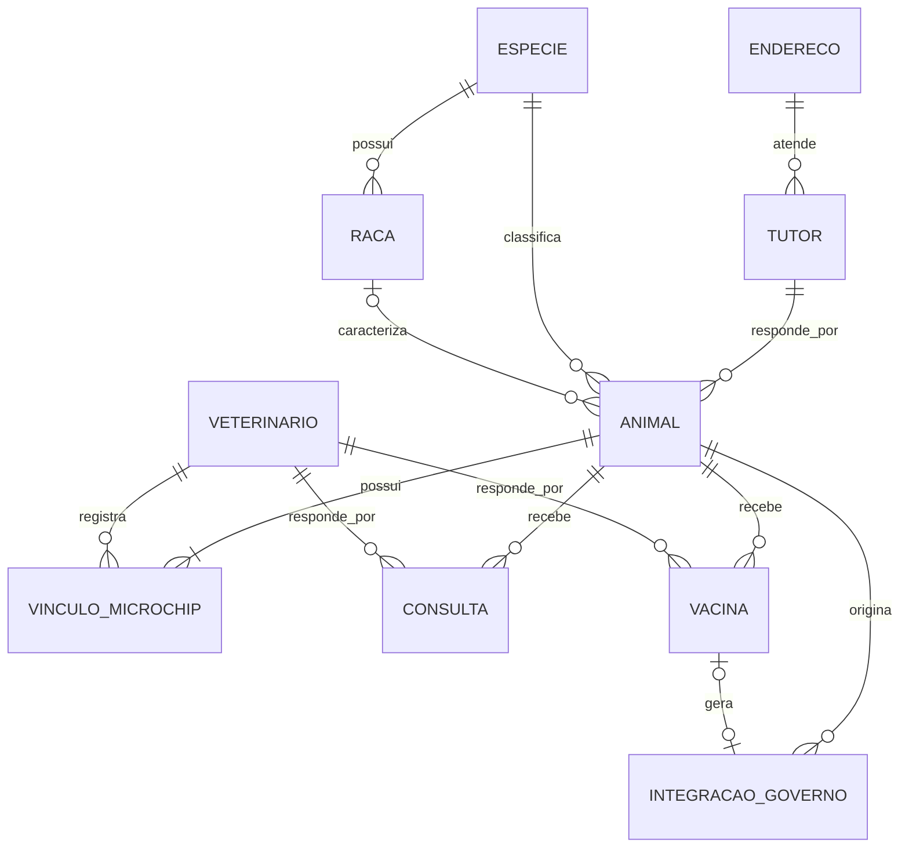

# Milestone 1 — DER e modelo relacional

**A3 de Sistemas Distribuídos e Mobile · Sistema de Gestão de Clínica Veterinária**

Este modelo cobre as dez entidades obrigatórias da API privada da clínica. O esquema usa tipos PostgreSQL e serve de referência para os modelos Python e as migrações da Milestone 2. A API governamental simulada tem persistência separada e recebe dados por HTTP, sem chaves estrangeiras entre bancos.

## Diagrama entidade-relacionamento

Um animal cadastrado tem um vínculo vigente e pode acumular vínculos encerrados. Uma aplicação de vacina tem uma comunicação quando é antirrábica e está aplicada. As demais operações de integração, como cadastro de animal, são vinculadas apenas ao animal.

## Dicionário de dados

Todas as tabelas têm `id BIGINT` gerado como chave primária. Os campos são obrigatórios por padrão. **Opcional** indica que a coluna aceita `NULL`, respeitando as regras condicionais. Campos agrupados na mesma linha têm o mesmo tipo e a mesma obrigatoriedade. As situações são valores textuais restritos com `CHECK`.

### 1. Endereço — `endereco`

| Campo | Tipo | Regra |
|---|---|---|
| cep | VARCHAR(8) | Oito dígitos sem máscara |
| logradouro | VARCHAR(160) | |
| numero | VARCHAR(20) | Texto para admitir valores como 12A |
| complemento | VARCHAR(120) | Opcional |
| bairro, cidade | VARCHAR(120) | |
| uf | VARCHAR(2) | Sigla de UF válida |
| codigo_ibge | VARCHAR(7) | Opcional, sete dígitos quando informado |

### 2. Tutor — `tutor`

| Campo | Tipo | Regra |
|---|---|---|
| nome_completo | VARCHAR(150) | |
| cpf | VARCHAR(11) | Único, normalizado e validado pela API |
| data_nascimento | DATE | |
| email | VARCHAR(254) | |
| telefone | VARCHAR(20) | |
| endereco_id | BIGINT | FK para `endereco.id` |
| cadastrado_em | TIMESTAMPTZ | Data e hora do cadastro |
| situacao | VARCHAR(10) | ATIVO ou INATIVO |

### 3. Espécie — `especie`

| Campo | Tipo | Regra |
|---|---|---|
| nome | VARCHAR(80) | |
| descricao | TEXT | |
| situacao | VARCHAR(10) | ATIVA ou INATIVA |

### 4. Raça — `raca`

| Campo | Tipo | Regra |
|---|---|---|
| especie_id | BIGINT | FK para `especie.id` |
| nome | VARCHAR(80) | |
| descricao | TEXT | |
| situacao | VARCHAR(10) | ATIVA ou INATIVA |

Criar `UNIQUE (id, especie_id)` como alvo da referência composta de animal.

### 5. Veterinário — `veterinario`

| Campo | Tipo | Regra |
|---|---|---|
| nome_completo | VARCHAR(150) | |
| cpf | VARCHAR(11) | Onze dígitos sem máscara |
| numero_crmv | VARCHAR(20) | Identificação textual do conselho |
| uf_crmv | VARCHAR(2) | Sigla de UF válida |
| email | VARCHAR(254) | Normalizado e único para login |
| telefone | VARCHAR(20) | |
| senha_hash | TEXT | Hash da senha |
| senha_confirmada | BOOLEAN | Padrão falso |
| senha_confirmada_em | TIMESTAMPTZ | Opcional até a confirmação |
| cadastrado_em | TIMESTAMPTZ | |
| situacao | VARCHAR(10) | ATIVO ou INATIVO |
| ultimo_acesso_em | TIMESTAMPTZ | Opcional até o primeiro login |

Usar `UNIQUE (numero_crmv, uf_crmv)`. O indicador de confirmação deve coincidir com a presença de `senha_confirmada_em`. A API verifica confirmação e situação antes de conceder acesso.

### 6. Animal — `animal`

| Campo | Tipo | Regra |
|---|---|---|
| nome | VARCHAR(100) | |
| data_nascimento | DATE | Opcional se houver idade estimada |
| idade_estimada_meses | INTEGER | Opcional se houver data de nascimento, não negativa |
| sexo | VARCHAR(20) | |
| cor | VARCHAR(80) | |
| peso_atual_kg | NUMERIC(8,3) | Maior que zero |
| tutor_id | BIGINT | FK para `tutor.id` |
| especie_id | BIGINT | FK para `especie.id` |
| raca_id | BIGINT | Opcional. FK composta `(raca_id, especie_id)` para `raca(id, especie_id)` |
| situacao | VARCHAR(20) | ATIVO, INATIVO ou ÓBITO |

Exigir ao menos uma referência de idade. Quando informada, a raça deve ser da espécie selecionada. O RFID atual, sua data e seu veterinário vêm do vínculo vigente.

### 7. Vínculo de microchip — `vinculo_microchip`

| Campo | Tipo | Regra |
|---|---|---|
| animal_id | BIGINT | FK para `animal.id` |
| veterinario_id | BIGINT | FK para `veterinario.id` |
| codigo_rfid | VARCHAR(40) | Único, inclusive no histórico. Armazenado como texto para preservar zeros iniciais. |
| vinculado_em | TIMESTAMPTZ | Data da implantação ou vinculação registrada |
| encerrado_em | TIMESTAMPTZ | Opcional. Se informado, deve ser igual ou posterior a `vinculado_em`. |

Um índice único parcial em `animal_id` para linhas com `encerrado_em IS NULL` impede dois vínculos vigentes. A API cria o animal e seu primeiro vínculo na mesma transação. Na troca, bloqueia a linha do animal durante a transação, encerra o vínculo anterior e cria o novo. O veterinário é identificado pela sessão autenticada e deve estar ativo e autorizado.

### 8. Consulta — `consulta`

| Campo | Tipo | Regra |
|---|---|---|
| animal_id | BIGINT | FK para `animal.id` |
| veterinario_id | BIGINT | FK para `veterinario.id` |
| data_hora | TIMESTAMPTZ | Horário do atendimento ou agendamento |
| motivo | TEXT | |
| anamnese, sintomas, diagnostico, tratamento_prescrito | TEXT | Opcionais no agendamento. Preenchidos quando aplicáveis ao atendimento. |
| prescricao_medicamentos, observacoes | TEXT | Opcionais |
| peso_registrado_kg | NUMERIC(8,3) | Opcional no agendamento, obrigatório na consulta realizada e positivo |
| temperatura_c | NUMERIC(5,2) | Opcional, informada quando aferida |
| situacao | VARCHAR(20) | AGENDADA, REALIZADA, CANCELADA ou NAO_COMPARECEU |

### 9. Aplicação de vacina — `vacina`

| Campo | Tipo | Regra |
|---|---|---|
| animal_id | BIGINT | FK para `animal.id` |
| veterinario_id | BIGINT | FK para `veterinario.id` |
| nome_vacina | VARCHAR(120) | |
| tipo_vacina | VARCHAR(60) | Tipo ou categoria da vacina |
| antirrabica | BOOLEAN | Classificação estruturada |
| fabricante, numero_lote | VARCHAR(120) | Opcionais no agendamento, obrigatórios quando aplicada |
| data_agendada | DATE | Opcional, obrigatória quando agendada |
| data_aplicacao | DATE | Opcional, obrigatória quando aplicada |
| dose_etapa | VARCHAR(60) | |
| via_aplicacao | VARCHAR(60) | Opcional no agendamento, obrigatória quando aplicada |
| proxima_dose_em | DATE | Opcional |
| validade_lote | DATE | Opcional no agendamento, obrigatória quando aplicada |
| observacoes | TEXT | Opcional |
| situacao | VARCHAR(10) | AGENDADA, APLICADA ou CANCELADA |

A data da próxima dose, quando informada junto à data da aplicação, deve ser posterior a ela. Criar `UNIQUE (id, animal_id)` como alvo da referência composta de integração.

### 10. Integração com o governo — `integracao_governo`

| Campo | Tipo | Regra |
|---|---|---|
| animal_id | BIGINT | FK para `animal.id` |
| vacina_id | BIGINT | Opcional. FK composta `(vacina_id, animal_id)` para `vacina(id, animal_id)` |
| tipo_operacao | VARCHAR(25) | CADASTRO_ANIMAL, ATUALIZACAO_ANIMAL ou VACINA_ANTIRRABICA |
| chave_idempotencia | UUID | Única e reutilizada em todos os reenvios da mesma operação |
| protocolo_externo | VARCHAR(100) | Opcional até ser retornado pelo serviço externo |
| situacao | VARCHAR(12) | PENDENTE, ENVIADA, CONFIRMADA ou FALHA |
| solicitada_em | TIMESTAMPTZ | |
| respondida_em | TIMESTAMPTZ | Opcional até existir resposta |
| quantidade_tentativas | INTEGER | Padrão zero, não negativa |
| mensagem_erro | TEXT | Opcional |
| payload_envio | JSONB | Cópia dos dados usados na solicitação original |

Apenas `VACINA_ANTIRRABICA` exige e admite `vacina_id`. Usar `UNIQUE (vacina_id)` para uma única comunicação local por aplicação. Atualizar a mesma linha em novas tentativas. A FK composta garante que a vacina pertence ao animal indicado na integração. A API garante que a vacina está aplicada e é antirrábica.

## Regras de persistência e integração

1. **Cadastro e histórico.** Validar CPF do tutor na API e garantir unicidade no banco. Normalizar o CPF antes de gravar. Para entidades com inativação, mudar a situação e preservar referências históricas. Usar FKs sem exclusão em cascata nos históricos clínicos e de integração.
2. **Vacinação antirrábica.** Gravar a aplicação local e a comunicação PENDENTE na mesma transação. O payload registra RFID vigente, identificação do animal e da vacina, data da aplicação, fabricante, lote e identificação do veterinário. A cópia permite repetir a comunicação original mesmo que os dados cadastrais ou o chip mudem depois.
3. **Envio.** Tentar o HTTP após confirmar a transação local. Criar a comunicação mesmo quando o animal ainda não tem cadastro externo. Se o serviço simulado exigir esse cadastro para receber a vacinação, sincronizar o animal e retomar o envio com a mesma chave.
4. **Estados.** PENDENTE indica solicitação pronta para envio ou reenvio. ENVIADA indica tentativa em andamento ou recebimento ainda sem confirmação final. CONFIRMADA registra o protocolo da operação aceita. FALHA indica rejeição que requer tratamento. Timeout e indisponibilidade retornam a operação para PENDENTE. Uma tentativa ENVIADA que expirar também deve voltar para PENDENTE.
5. **Idempotência no serviço externo.** A API governamental simulada deve gravar o efeito da operação e seu resultado associado à chave na mesma transação, com unicidade no próprio banco. Ao receber novamente a mesma solicitação, devolve o protocolo original. A clínica deve reutilizar a chave inclusive se perder a resposta depois de o serviço externo gravar a operação.
6. **Índices de consulta.** Indexar consultas por animal e data, vacinas por animal e data de aplicação, e integrações por situação e data de solicitação.

## Decisões de projeto

O enunciado define as entidades, os atributos mínimos e as regras de negócio. Os tipos PostgreSQL, os tamanhos de texto, os valores propostos para a situação do animal, o RFID derivado do vínculo vigente, a data de agendamento da vacina e a cópia do payload são decisões deste modelo. As restrições condicionais foram escolhidas para permitir agendamentos antes do atendimento ou da aplicação.

**Fonte** — A3-SDM.pdf, seções 3 a 6.
